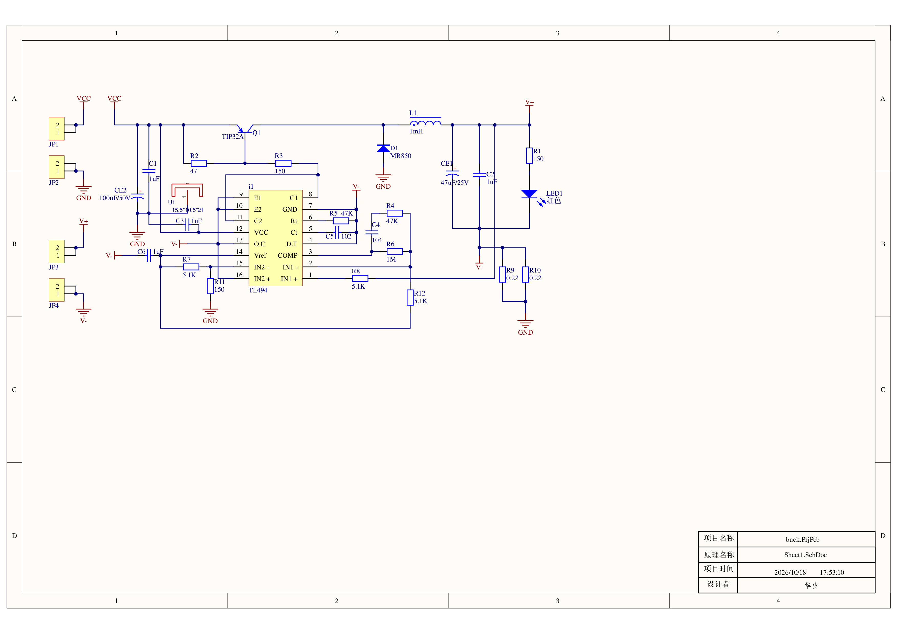
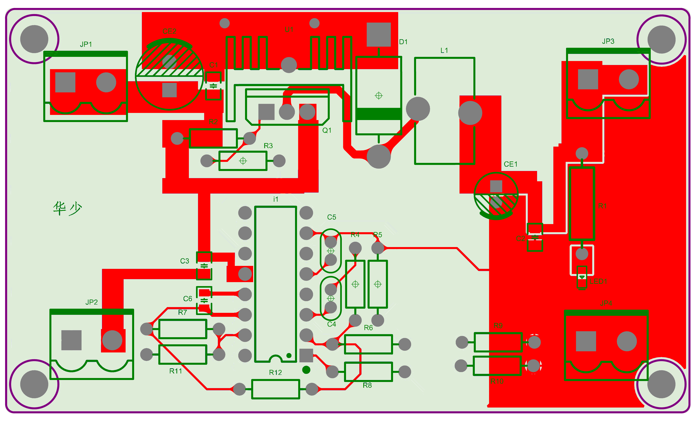
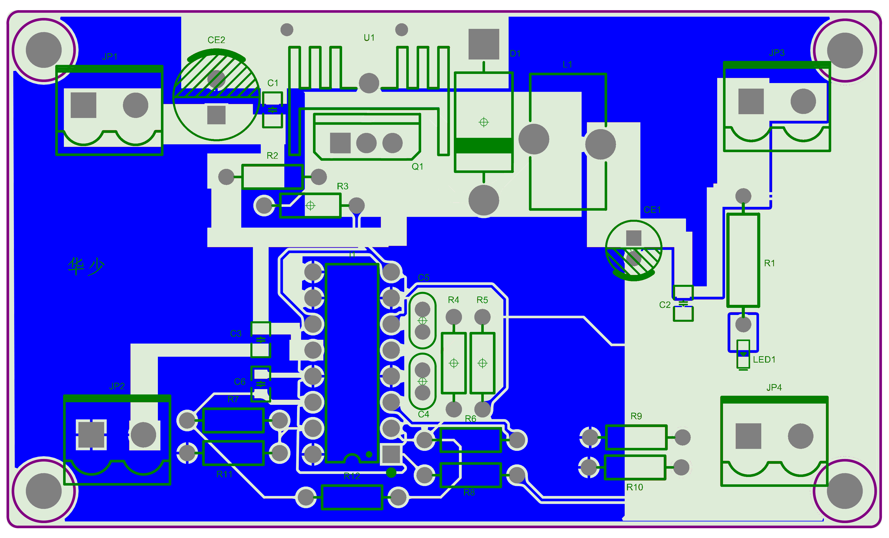

# TL494 Buck 降压变换器 / TL494 Buck Converter

> 10–40 V 宽输入、5 V / 1 A 输出的非隔离 Buck 变换器。TL494 电压模式 PWM + 高边 PNP（TIP32A）直接驱动，**不加任何驱动 IC**，单板 78 × 43 mm 双层板。
>
> A non-isolated buck converter built around the TL494 in voltage-mode control, with a high-side PNP (TIP32A) switch driven directly — no gate/current driver ICs. 10–40 V in, 5 V / 1 A out, 78 × 43 mm 2-layer board.




<p align="center">
  
  
</p>

---

## 特性 / Features

- **宽输入 10–40 V，稳压输出 5 V / 1 A**，满载效率 79.6 %。
- **无驱动 IC**：高边 PNP 由 TL494 经 R2/R3 基极分压网络直接驱动，靠控制饱和深度开通/关断，省掉专用驱动芯片。
- **恒流限流 + 输出短路保护**：0.11 Ω 低边采样 + 5 V 基准分压得到 0.143 V 阈值，输出电流超过 ≈1.3 A 时逐周期压缩占空比。
- **1 mH 储能电感**按 13 % 电流纹波设计，配合 47 µF/25 V 电解 + 1 µF 陶瓷输出滤波。
- **完整可打样**：Gerber、NC Drill、贴片坐标、装配图、BOM 全部随仓库提供，源文件为 Altium Designer 工程。

## 规格 / Specifications

| 参数 | 数值 | 备注 |
| --- | --- | --- |
| 输入电压 V<sub>in</sub> | 10 – 40 V DC | 输入电容 CE2 100 µF/50 V |
| 输出电压 V<sub>out</sub> | 5 V | 负载调整率实测 1.2 % |
| 最大输出电流 | 1 A（限流点 ≈1.3 A） | 恒流限流 + 短路保护 |
| 开关频率 f<sub>sw</sub> | 23 kHz | R<sub>t</sub> = 47 kΩ，C<sub>t</sub> = 1 nF |
| 满载效率 | 79.6 % | 12 V → 5 V / 1 A |
| 输出纹波 | ≈20 mV | 满载 |
| 满载温升 | ≈45 ℃ | TIP32A 配铝散热片 |
| 拓扑 | 非隔离、单端 Buck、异步整流 | 共地 |
| 板尺寸 | 78.0 × 43.0 mm | 双层，1.6 mm FR-4 |
| 元件数量 | 30（不含 PCB） | 见 [docs/BOM.csv](docs/BOM.csv) |

## 原理与设计要点 / Design Notes

**控制环**
TL494 接成电压模式单端输出：内部误差放大器比较 5 V 基准与输出取样分压，经 RC 网络（R4 47 kΩ / C4 100 nF，R6 1 MΩ，C5 1 nF）补偿后调制占空比。R<sub>t</sub> = 47 kΩ、C<sub>t</sub> = 1 nF，开关频率 ≈23 kHz——在 BJT 开关损耗与电感体积之间取的折中。

**开关级**
Q1（TIP32A，PNP）做高边开关，R2 47 Ω / R3 150 Ω 组成基极分压驱动网络，用饱和深度替代推挽驱动，因此不需要额外驱动 IC；代价是基极驱动损耗与较长的关断拖尾，这是效率的主要瓶颈之一。D1（MR850 肖特基）续流，L1（1 mH 磁环）储能。

**电感设计**
按 13 % 电流纹波反推匝数：
ΔI<sub>L</sub> = (V<sub>in</sub> − V<sub>out</sub>) · D / (L · f<sub>sw</sub>) ≈ (12 − 5) × 0.417 / (1 mH × 23 kHz) ≈ 0.125 A ≈ 12.5 %（@ 12 V 输入、1 A 满载），留有余量后取 1 mH。

**采样与保护**
输出回流经 R9 ∥ R10 = 0.11 Ω 低边采样电阻接地；该电压与 15 脚由 R7（5.1 K）/R11（150 Ω）分压得到的 0.143 V 基准比较，超过阈值（对应输出 >1.3 A）时 TL494 逐周期压缩占空比，形成恒流限流与输出短路保护。

**指示与接口**
JP1–JP4 为 KF2EDGK-5.08 两位接插件（输入/输出各两组）；R1 150 Ω 串红色 LED 作输出指示。

**损耗拆解**
满载损耗集中在三处：TIP32A 饱和压降、基极驱动电流、续流二极管正向损耗。

## PCB 布局规则 / Layout Guidelines

完整规则整理在 **[docs/layout-guidelines.md](docs/layout-guidelines.md)**（原稿 `docs/layout-rules-original.docx`），含走线宽度表、避坑清单、口诀和改板自查 checklist。要点：

- **两类规则**：电流 di/dt 大 → 走线短、压环路面积；电压 dV/dt 大 → 铜皮能小就小。优先级 **短 > 粗 > 不铺**。
- **SW 节点**：Q1-C → D1-K → L1 全长 ≤ 1 cm、1–2 mm 粗线，**禁止铺铜**；与地铜间距 ≥ 0.5 mm；底层 GND 在 SW 正下方挖空 0.5–1 mm（间距只影响寄生电容，不改变环路面积）。
- **浮地结构**：TL494 7 脚接 V-，芯片以 V- 为参考 → **分割 V-（功率 / 信号两块，单点落在 R9/R10 上端），GND 整片功率铜不分割**。
- **反馈**：R8 从输出端子采 V+ 到 IN1+，R12/R6 把 IN1- 钉在 ≈4.975 V，R4 ∥ C4 做补偿；采样点靠端子、反馈电阻靠芯片、中间 0.2–0.3 mm 细线，远离 SW 与 L1。
- **分区**：C1/CE2/Q1/D1 紧贴成换流三角；TL494 远离电感与环路，**12 / 14 脚各补 0.1 µF 去耦到信号 V-**。

## 实测结果 / Measurements

测试条件：V<sub>in</sub> = 12 V，V<sub>out</sub> = 5 V，I<sub>out</sub> = 1 A。

| 指标 | 实测 | 对照 |
| --- | --- | --- |
| 效率 | **79.6 %** | 同规格 BJT 分立方案典型值 75–87 % |
| 负载调整率 | 1.2 % | — |
| 输出纹波 | ≈20 mV | — |
| 满载温升 | ≈45 ℃ | TIP32A + 铝散热片 |

> 效率瓶颈即"不加驱动 IC"这一约束的代价：换成低 R<sub>ds(on)</sub> MOS + 同步整流后预期可显著提升（见下方路线图）。

## 仓库结构 / Repository Layout

```
buck/
├── hardware/                     Altium Designer 工程（设计源文件）
│   ├── buck.PrjPcb               工程文件
│   ├── Sheet1.SchDoc             原理图源文件
│   ├── PCB1.PcbDoc               PCB 源文件
│   ├── Sheet1.pdf                原理图 PDF
│   ├── Composite Drawing.pdf     顶/底铜层复合图（PCB 预览图来源）
│   └── Project Outputs for buck/ BOM 源表（buck.xlsx）
├── fabrication/                  可直接送打样的生产文件
│   ├── gerber/                   Gerber (RS-274X)、NC 钻孔、贴片坐标、IPC 网表
│   ├── assembly/                 装配图 PDF
│   └── stencil/                  钢网层与钢网图（SMD：4×0805 + 1×0603）
├── docs/
│   ├── schematic.png             原理图预览
│   ├── pcb-top.png / pcb-bottom.png   PCB 预览（顶层红铜 / 底层蓝铜）
│   ├── layout-guidelines.md      PCB 布局规则（含改板 checklist）
│   ├── layout-rules-original.docx 布局笔记原稿
│   └── BOM.csv                   物料清单
├── LICENSE                       CERN-OHL-P-2.0
└── README.md
```

## 复现 / Making One

1. **打板**：把 `fabrication/gerber/` 整个目录打成 zip 直接下单，2 层、1.6 mm FR-4、喷锡或沉金均可，外形 78 × 43 mm（四角 R3 mm）。
2. **备料**：按 [docs/BOM.csv](docs/BOM.csv)。注意 TIP32A 需要 15.5 × 10.5 × 21 mm 铝散热片 **+ 云母绝缘片**（TO-220 背面与散热片之间必须绝缘，散热片固定在 Q1 上且不接地）。
3. **贴片**：C1、C2、C3、C6 为 0805，LED1 为 0603，可用 `fabrication/stencil/` 的钢网层。
4. **插件与调试**：先校 5 V 基准（TL494 14 脚）、再空载测 V<sub>out</sub>，最后带载至 1 A 并观察纹波与 Q1 温度。
5. **注意**：输出与输入共地，**非隔离**；输入端 40 V 时 CE2 余量有限，勿超压。

## 已知问题与路线图 / Known Issues & Roadmap

- **效率瓶颈**：TIP32A 饱和压降 + 基极驱动 + 续流二极管三处损耗。下一步改为低 R<sub>ds(on)</sub> MOS + 同步整流，预期效率明显提升。
- **开关频率偏低（23 kHz）**：电感 1 mH、体积偏大；提高频率需重新权衡 BJT 开关损耗与驱动设计。
- **保护不完整**：尚无输入反接保护、欠压锁定门限可再校核，建议 v1.1 补上。
- **限流阈值待核实**：15 脚（IN2-）基准由 R7/R11 分压决定。按 BOM 的 R11 = 150 Ω、R7 = 5.1 K，基准 ≈0.143 V、限流 ≈1.3 A；若按 R11 = 5.1 K 计算则是 2.5 V / ≈22.7 A，显然过高。两种结论只差一个电阻取值，**以 `hardware/PCB1.PcbDoc` 网络表为准**，详见 [布局规则第 5 节](docs/layout-guidelines.md)。
- **去耦缺失**：TL494 12 脚 VCC 与 14 脚 Vref 的 0.1 µF 去耦在原理图上没有画出，PCB 上应补，且要接信号 V-（7 脚）而非 GND。
- **LED 限流电阻偏小**：R1 = 150 Ω 时约 20 mA，建议改 330–470 Ω。
- **补偿网络**：当前 RC 取值实测稳定，但瞬态响应与相位裕度未做完整频响测量。
- **EMI**：未做传导/辐射预测试，输入侧未加共模电感。

欢迎 issue / PR 补充实测数据或改进设计。

## 许可 / License

本仓库的硬件设计文件（原理图、PCB、Gerber、BOM、文档）均以 **[CERN-OHL-P-2.0](LICENSE)**（CERN Open Hardware Licence Version 2 – Permissive）发布：可自由使用、修改、制造与销售，需保留版权与许可声明。

Hardware design files in this repository are released under the **CERN Open Hardware Licence Version 2 – Permissive**. You may use, modify, manufacture and sell products based on them, provided you keep the notices.

## 致谢 / Credits

- 设计、制板、调试：刘帮华（2026.03 – 2026.06）
- 工具：Altium Designer

---

### English Summary

A TL494-based, non-isolated buck converter accepting 10–40 V and delivering 5 V / 1 A on a 78 × 43 mm two-layer board. The TL494 runs voltage-mode PWM at 23 kHz; a high-side PNP (TIP32A) is driven through a resistor network directly from the controller — deliberately avoiding a dedicated driver IC, with saturation depth used as the switching mechanism. A 1 mH inductor holds the ripple near 13 %, an MR850 Schottky handles freewheeling, and a 0.11 Ω low-side shunt plus a divided 5 V reference forms a cycle-by-cycle current limit at ≈1.3 A. Measured at 12 V → 5 V / 1 A: 79.6 % efficiency, 1.2 % load regulation, ≈20 mV ripple, ≈45 ℃ temperature rise. Gerbers, drill files, pick-and-place data, assembly drawings and BOM are included, so the board can be ordered and built as-is. Licensed CERN-OHL-P-2.0.
